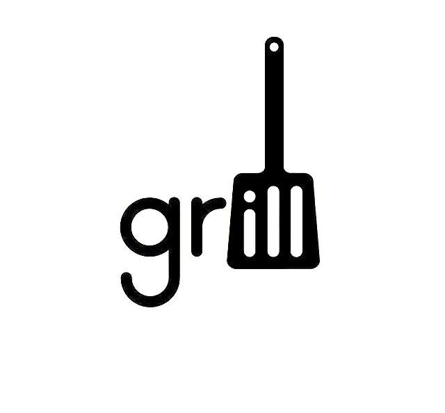
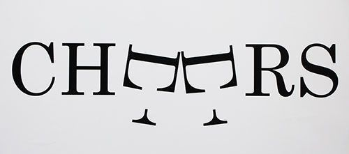
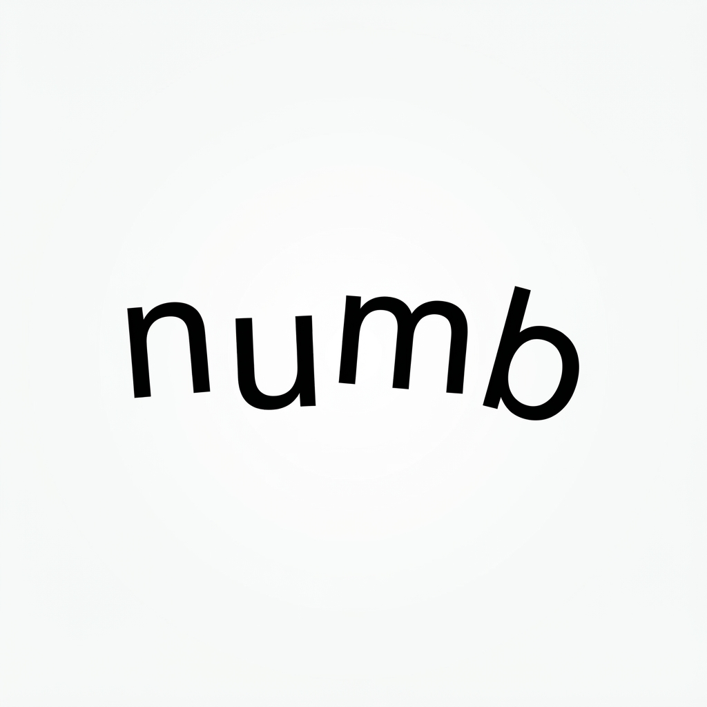

# Expressive Typography Corpus

**Five primitives. Every expressive typographic act we examined.**

Expressive typography makes a letterform carry meaning while the word stays readable. This corpus argues that all such acts decompose into five operations, each acting on a different property of a single letterform:

| Primitive | Acts on | Meaning is encoded in... |
|---|---|---|
| **Substitution** | identity | what the letterform is replaced by or revealed to contain |
| **Mutation** | structure | how its geometry is deformed |
| **Suppression** | presence | its absence |
| **Extension** | boundary | where its geometry ends |
| **Inflection** | state | its non-geometric attributes (position, orientation, scale, fill, attached effects) |

**Why these are irreducible:** each primitive changes a property the others leave untouched, so none can be rebuilt from the rest. The claim is tested, not proven. Stress-testing eliminated one candidate (Elevation) and folded another (Integration) into the remaining set, and the taxonomy stays open to revision. The full argument is in [TAXONOMY.md](TAXONOMY.md).

The corpus holds **50 annotated entries**, each scored 1 to 5 on a Surprise-Legibility Ratio. Low scores are included on purpose, including AI-generated failures, so the scale has a floor and shows where current image models break.

---

## What Each Entry Records

Every entry documents the operation and the reasoning behind it:

- **Classification:** primary primitive, up to two secondary primitives, and whether each secondary *enables*, *amplifies*, or *contrasts* the primary.
- **Semantics:** the concept encoded, and the semantic mechanism (why this letter, why this operation).
- **Quality:** legibility integrity, the Surprise-Legibility Ratio, a curatorial note, and, when the analysis yields one, a transferable generative principle.

Full field definitions and the 1-to-5 anchor descriptions are in [SCHEMA.md](SCHEMA.md).

---

## Worked Examples

### A single-primitive entry: ET-001 *grill*



| | |
|---|---|
| **Primary primitive** | Substitution |
| **Secondary primitives** | none |
| **Target glyphs** | i, l, l |
| **Concept encoded** | A grilling spatula |
| **Legibility** | Full |
| **Surprise-Legibility** | **5** |

The three vertical strokes of "ill" are unified into the silhouette of a spatula, with the stems becoming the blade's slots. The designer did not impose an object onto the letters. They found one already latent in the word's geometry, and no other letters in "grill" could have produced it.

**Generative principle:** strong Substitution introduces an object already latent in the word's specific geometry and uses it to form an expressive typographic relationship.

---

### A compound entry: ET-004 *CHEERS*



| | |
|---|---|
| **Primary primitive** | Mutation |
| **Secondary primitives** | Inflection (*enables*) |
| **Target glyphs** | both E's |
| **Concept encoded** | Two wine glasses clinking in a toast |
| **Legibility** | Partial |
| **Surprise-Legibility** | **5** |

Mutation detaches each E's crossbar from its stem, creating a glass-like form. Inflection rotates both E's 90 degrees and tilts them toward each other so the bowls touch. Mutation creates the glass and Inflection performs the toast, and neither works without the other. The word's two adjacent E's are the structural gift that makes the pair possible.

**Generative principle:** when a word names a gesture performed with a paired object, look for repeated letterforms whose geometry approximates that object under rotation and minimal modification.

---

### A failure: ET-044 *numb* (AI-generated)



| | |
|---|---|
| **Primary primitive** | Inflection |
| **Secondary primitives** | none |
| **Target glyphs** | n, u, m, b |
| **Concept encoded** | Intended: numbness. Achieved: agitation |
| **Legibility** | Full |
| **Surprise-Legibility** | **1** |

The model chose the right primitive and displaced the right letters, and the execution is clean. But it displaced all four letterforms equally, which reads as agitation, the opposite of numbness. Numbness needs something to stay still. The typography argues against the word it spells.

**Generative principle:** when a word names an absence of response, Inflection must encode that absence through contrast. Some letterforms respond and one does not, and the unresponsive one carries the concept.

This entry shows the gap the corpus is built around. The model can execute an operation, but it cannot reliably reason about *which* letterform should carry it, and why.

---

## Corpus Distribution

| Primitive (as primary) | Entries |
|---|---|
| Substitution | 10 |
| Mutation | 10 |
| Suppression | 10 |
| Extension | 10 |
| Inflection | 10 |

| Surprise-Legibility score | Entries |
|---|---|
| 5 | 18|
| 4 | 13|
| 3 | 8 |
| 2 | 7 |
| 1 | 4 |

Compound entries (with at least one secondary primitive): **21**. AI-generated entries: **7**. Live counts are in [MATRIX.md](MATRIX.md).

---

## How to Use

The machine-readable export is [`exports/corpus.json`](exports/corpus.json), an array with one object per entry. Fields include `entry_id`, `word`, `source`, `primary_primitive`, `secondary_primitives`, `primitive_relationship`, `target_glyphs`, `operation_description`, `concept_encoded`, `semantic_mechanism`, `legibility_integrity`, `surprise_legibility_ratio`, `curatorial_note`, `generative_principle`, and `image` (a relative path).

```python
import json

with open("exports/corpus.json", encoding="utf-8") as f:
    corpus = json.load(f)

failures = [e for e in corpus if e["surprise_legibility_ratio"] <= 2]
suppression = [e for e in corpus if e["primary_primitive"] == "Suppression"]
```

The Markdown files in `entries/` are the source of truth. To rebuild the export after editing an entry, run `python scripts/build_corpus.py` (requires `pyyaml`).

| Folder | Contents |
|---|---|
| `entries/` | One annotated Markdown file per entry |
| `images/` | One image per entry, named to match |
| `exports/` | Generated `corpus.json` |
| `scripts/` | The export script |

---

## Known Limitations

- **One curator, one scorer.** Classifications and Surprise-Legibility scores are a single person's judgment, and there is no inter-annotator agreement yet. Challenges and corrections are welcome as issues.
- **Contemporary, web-sourced examples.** Most entries come from Pinterest. There are no historical examples (Dada, Futurist, Push Pin, Lubalin), so the universality claim has not been tested against them.
- **AI-generated entries come from one model family and from prompts written to provoke failure.** They show failure modes, not the model's average output.
- **Universality is argued, not proven.** The taxonomy was stress-tested against the examples collected here. Any example that resists the five primitives is a finding, and should be reported.

---

## License and Image Rights

| Component | License |
|---|---|
| Annotations, taxonomy, schema, and documentation | [CC BY 4.0](https://creativecommons.org/licenses/by/4.0/) |
| `scripts/` | MIT |
| Images of designs by third parties | **Not covered.** Copyright remains with the original creators. |
| AI-generated images | Included as research examples. The `source` field of each entry names the model. |

Images were collected from public sources, are credited where the designer is known, and are included for research and commentary. If you are a rights holder and want an image credited or removed, open an issue or contact the curator and it will be handled promptly.

---

## Citation

If you use this corpus, cite it using the "Cite this repository" button on GitHub, which reads [`CITATION.cff`](CITATION.cff), or:

> Bril. (2026). *Expressive Typography Corpus: A Five-Primitive Taxonomy and Annotated Dataset*. https://github.com/thisisbril/expressive-typography-corpus

---

## Documents

- [TAXONOMY.md](TAXONOMY.md): the theoretical framework, stress-testing, and universality argument
- [SCHEMA.md](SCHEMA.md): field definitions and scoring anchors
- [MATRIX.md](MATRIX.md): coverage targets and current distribution

## Curator

Bril